# Meeting summary

Branch `claude/kind-faraday-9o16ic`. Everything below is generated from files in the repository; the figures are in `style_vectors/figures/` and `tracks/compare/`.

## 1. The style vector, in one paragraph

For every lap and every corner we measure `z = (b, f, l, s)`, as in the problem formulation: `b` the share of the corner spent braking, `f` the share at full throttle,
`l` the line (lateral position at entry, apex and exit, as a fraction of the road half-width, +1 = inside edge), `s` the steering speed (full-lock sweeps per second).
Corners are fixed segments of the track found from the centerline curvature, so corner *k* is the same piece of road for every driver. We also describe each
braking zone (where it starts, how long it is, how much speed it takes off). The same code measures replays of humans and, later, laps of the RL agent.

## 2. The three candidate tracks

TMNF tracks that recreate a real circuit, fitted onto the real outline (green) with one rotation and one scale factor. Corner numbers follow the lap.

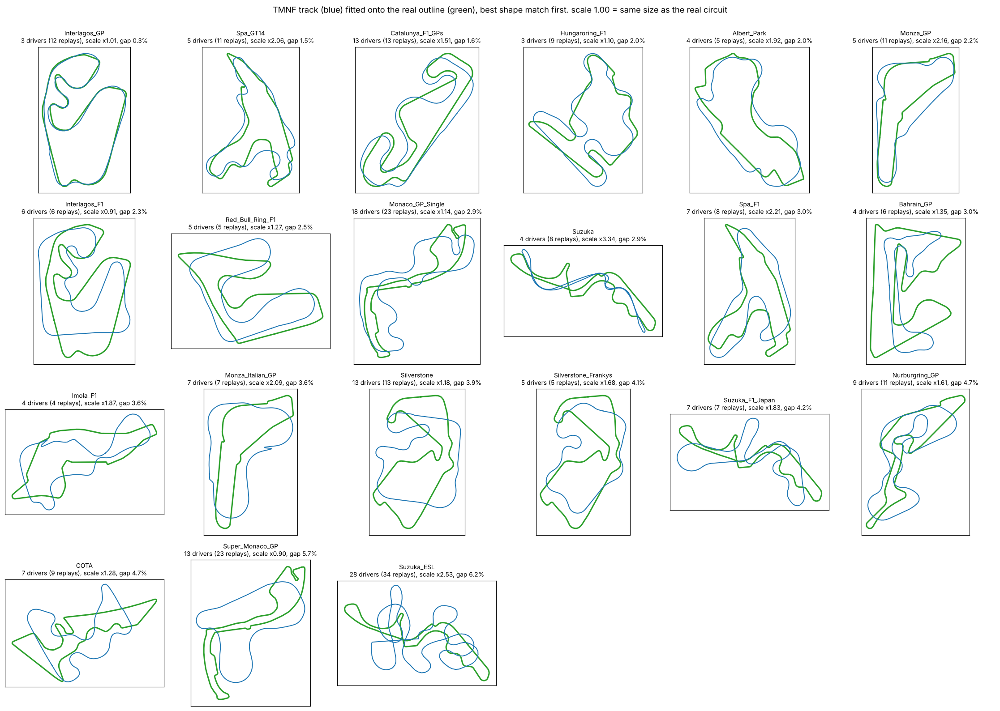

| track (tmnf.exchange id) | drivers | size vs real | shape gap | corners found, TMNF / real | in Assetto Corsa (from memory) |
|---|--:|--:|--:|--:|---|
| InterlagosGP [Unlimiter 2.0] (12851169) | 3 | 1.01 | 0.35 % (15 m) | 11 / 14 | mod only |
| F1 GPs: Catalunya (1482521) | 13 | 1.51 | 1.57 % (73 m) | 14 / 13 | Barcelona is DLC |
| Monza GP (5169102) | 5 | 2.16 | 2.17 % (126 m) | 10 / 10 | official |

"Size vs real" is the factor that scales the TMNF lap up to the real lap (1.00 = a 1:1 recreation). "Shape gap" is the RMS distance between the two outlines after the best fit.
Replays are not drivers: TMX keeps every improving personal best, so InterlagosGP has 12 replays but 3 drivers (10 are one driver on one day).
Pages: [Interlagos](https://tmnf.exchange/trackreplayshow/12851169), [Catalunya](https://tmnf.exchange/trackreplayshow/1482521), [Monza GP](https://tmnf.exchange/trackreplayshow/5169102).

**Interlagos: the only one at real size with a close shape**

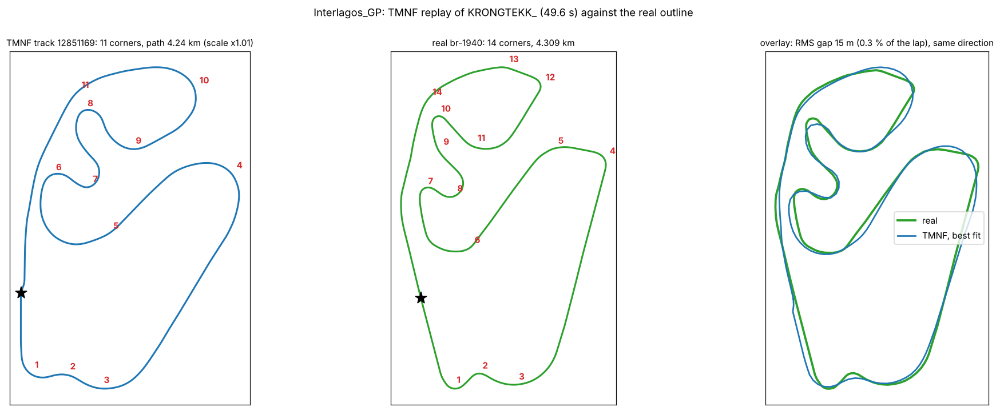

**Catalunya: 13 drivers, two thirds of real size**

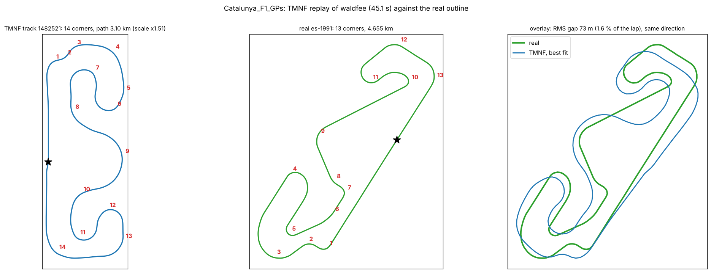

**Monza GP: recognisable, less than half real size, corner count matches**

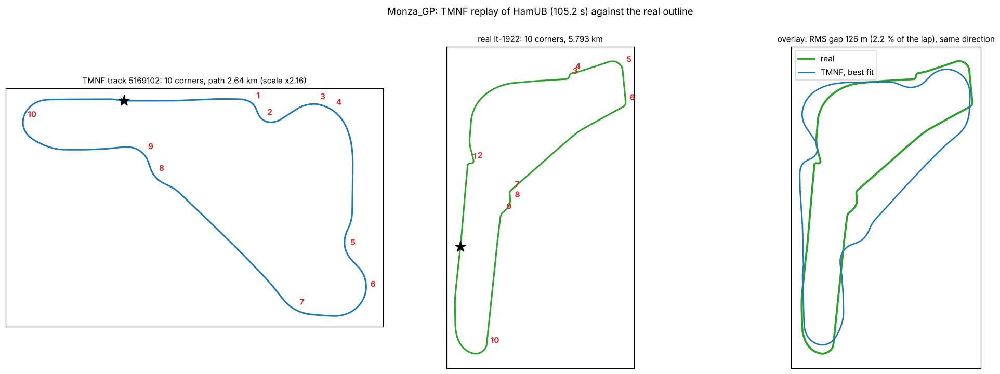

## 3. Style vectors of 3 or 4 drivers on each track

Each driver's fastest valid lap (the first lap for the multi-lap Monza GP). The line is measured against the fastest driver's own line on that track (his values are about 0 by construction).
Steering speed is not strictly comparable between keyboard and analog drivers. Brake point and brake zone are shown only for drivers who braked in at least 3 corners.
Columns: b = share of the corner braking, f = share at full throttle, s = steering speed, brake point = metres before the corner entry (negative = braking starts after the entry), entry/peak speed = speed at the corner entry over the lap's top speed.

### Interlagos (all three drivers use a keyboard)

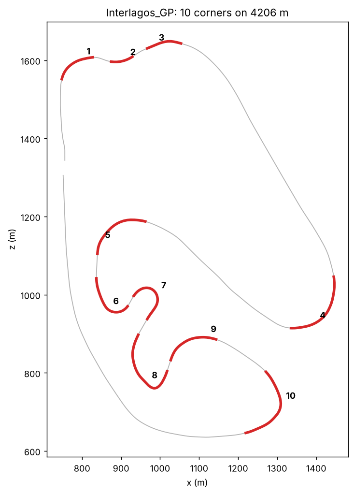

| driver | lap (s) | steering | braked corners | b | f | line at apex | s | brake point (m) | entry/peak speed | brake zone (m) |
|---|---|---|---|---|---|---|---|---|---|---|
| KRONGTEKK_ | 49.3 | digital | 6 | 0.077 | 0.88 | 0.025 | 2.227 | 29.681 | 0.634 | 61 |
| pietagorh | 55.5 | digital | 6 | 0.127 | 0.806 | -0.085 | 2.177 | -15.838 | 0.625 | 48.8 |
| qwaufey | 62.7 | digital | 6 | 0.111 | 0.86 | -0.084 | 2.798 | 16.636 | 0.544 | 53.3 |

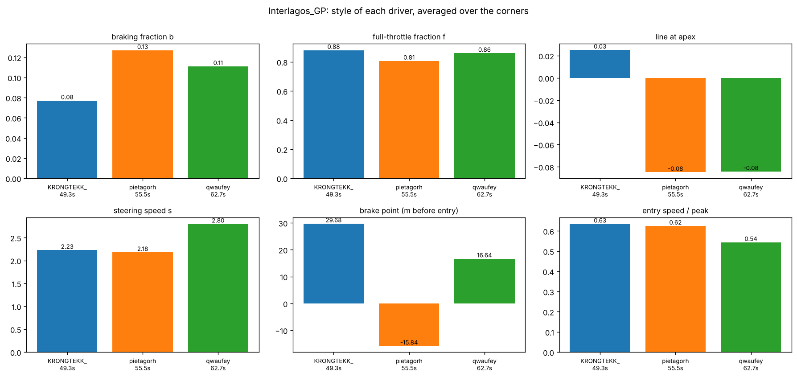

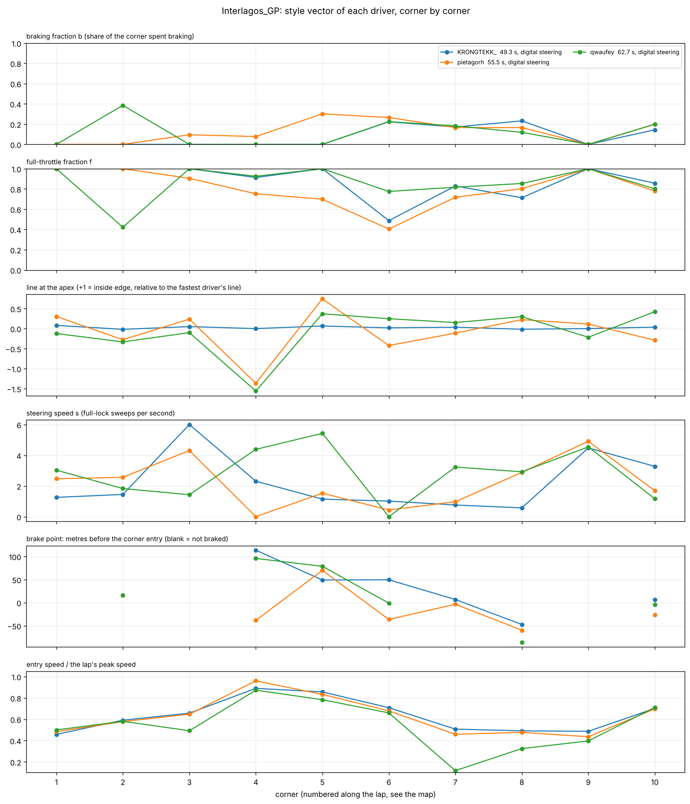

- The fastest driver (49.3 s) brakes the least (b 0.08, against 0.13 and 0.11), keeps the highest full-throttle share (0.88) and enters corners faster (0.63 against 0.54 for the slowest).
- The largest difference between drivers is the line at corner 4 (a spread of 1.6 road half-widths): both slower drivers are far from the fastest driver's line there.
- Steering speed is similar (2.2, 2.2, 2.8), but at corners 3 to 5 the spread is 4 to 4.6 sweeps per second.

### Catalunya (two keyboard drivers, two analog)

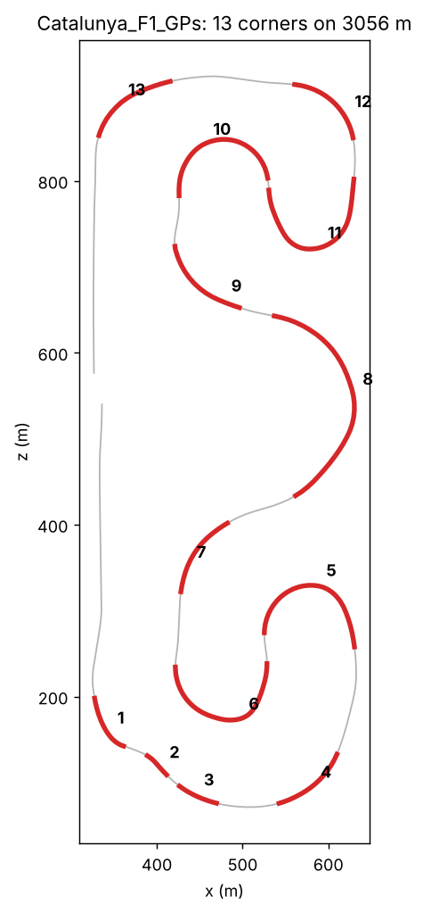

| driver | lap (s) | steering | braked corners | b | f | line at apex | s | brake point (m) | entry/peak speed | brake zone (m) |
|---|---|---|---|---|---|---|---|---|---|---|
| waldfee | 44.7 | digital | 7 | 0.083 | 0.808 | -0.016 | 1.735 | -20.31 | 0.712 | 22.7 |
| Cybernetic | 45.1 | analog | 6 | 0.176 | 0.774 | -0.012 | 1.743 | -9.796 | 0.667 | 50.4 |
| Zer0e | 46.9 | analog | 1 | 0.017 | 0.78 | -0.125 | 1.08 | n/a | 0.68 | n/a |
| Mansemus | 48.7 | digital | 6 | 0.091 | 0.742 | -0.195 | 2.481 | -49.114 | 0.705 | 20.5 |

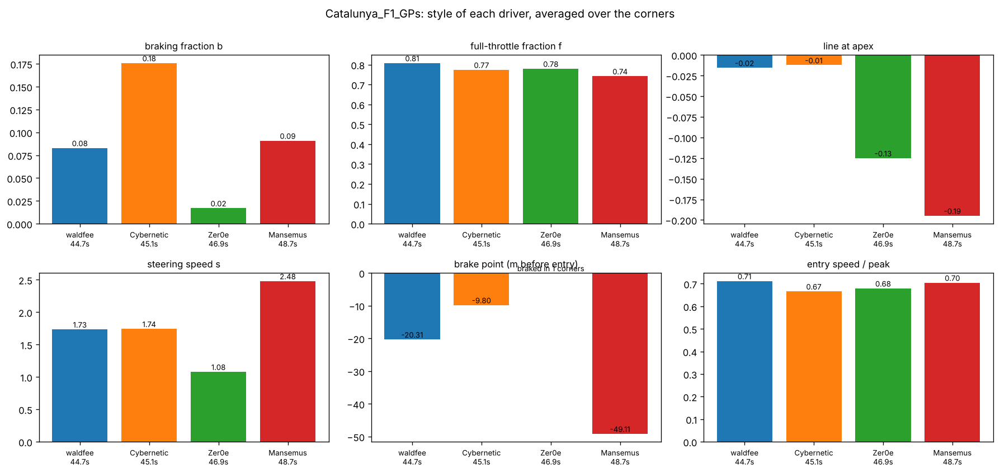

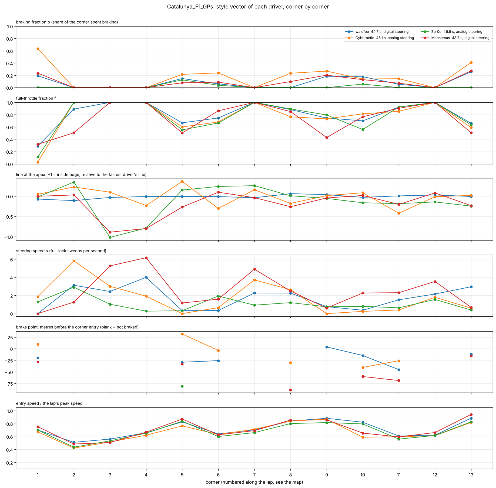

- Cybernetic (analog, 45.1 s) brakes the most: b 0.18, with 63 % of corner 1 spent braking. Zer0e (analog, 46.9 s) brakes in only one corner (b 0.02) and steers the least (s 1.08) but is only 2.2 s off the fastest.
- Two very different ways to be fast: the two fastest drivers have almost the same steering speed (1.7) but Cybernetic brakes twice as much as waldfee.
- Mansemus (keyboard, slowest, 48.7 s) steers fastest (s 2.48) and has the lowest full-throttle share (0.74). He and Zer0e take a very different line from the fastest driver at corners 3 and 4 (about one road half-width off).

### Monza GP (four keyboard drivers, first lap of a three-lap race)

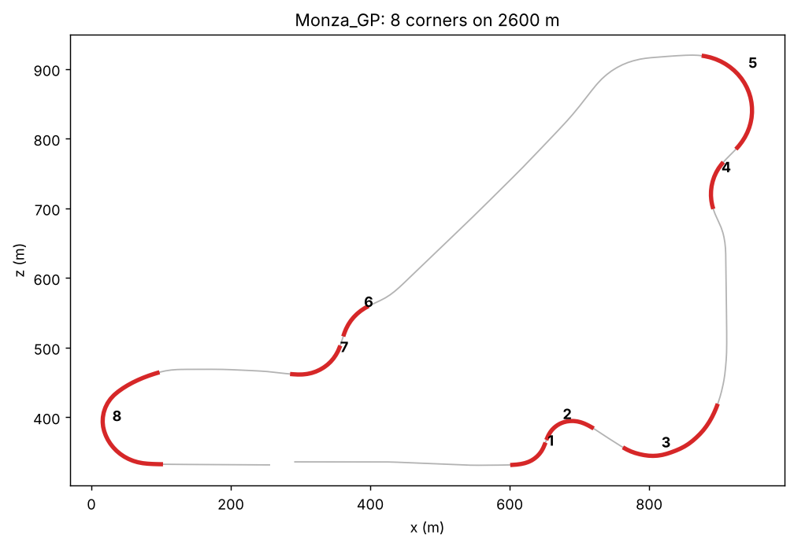

| driver | lap (s) | steering | braked corners | b | f | line at apex | s | brake point (m) | entry/peak speed | brake zone (m) |
|---|---|---|---|---|---|---|---|---|---|---|
| HamUB | 37.2 | digital | 4 | 0.072 | 0.828 | 0.002 | 1.608 | 19.594 | 0.587 | 34.8 |
| Front | 37.5 | digital | 4 | 0.092 | 0.81 | -0.035 | 1.557 | 26.187 | 0.615 | 49.5 |
| Del_Piero | 37.6 | digital | 4 | 0.096 | 0.825 | -0.003 | 2.612 | 41.762 | 0.61 | 56 |
| gm345 | 39.1 | digital | 4 | 0.062 | 0.714 | -0.029 | 1.42 | 31.786 | 0.562 | 42.1 |

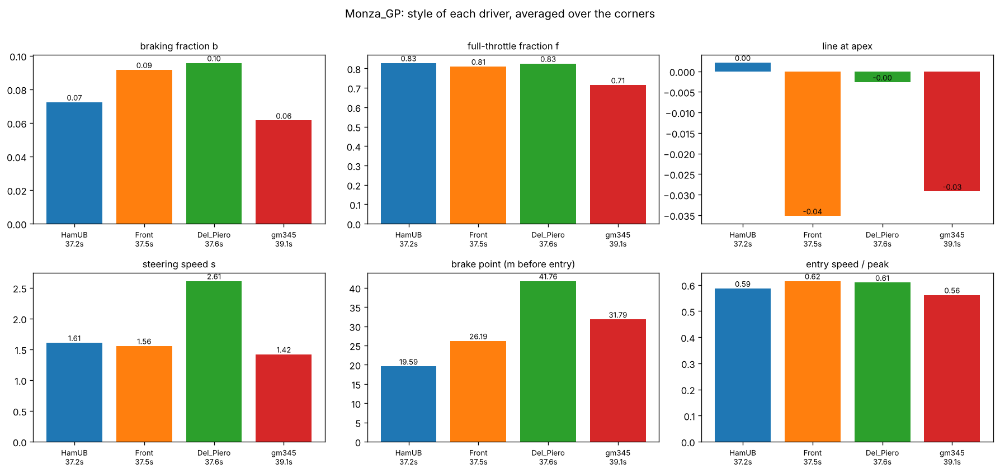

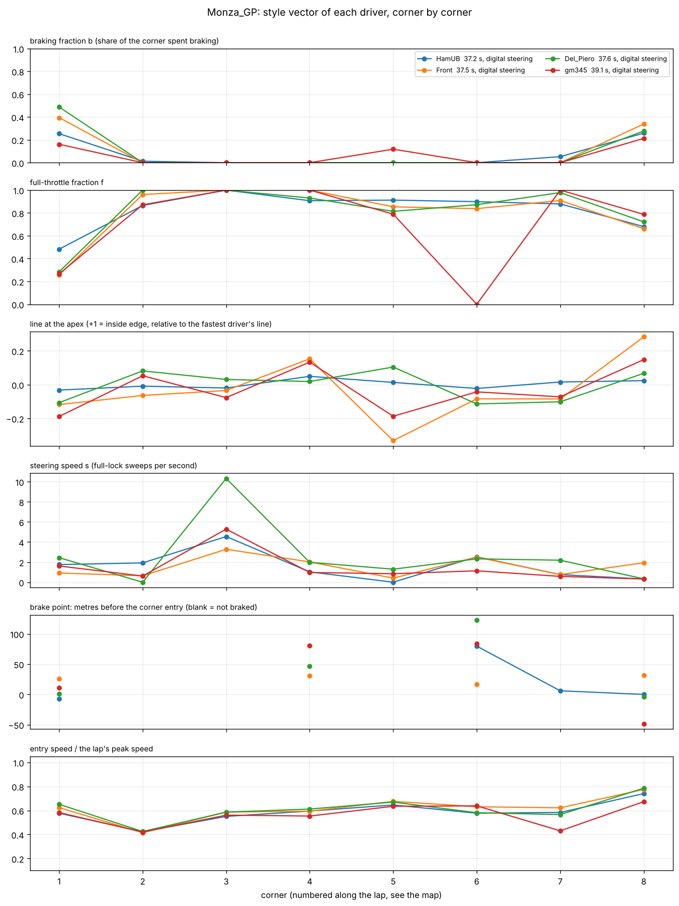

- The three fastest are within 0.4 s of each other but brake differently: HamUB starts braking 20 m before the corner entry, Front 26 m, Del_Piero 42 m, and the zone is 35, 50 and 56 m long.
- Del_Piero steers about 60 % faster (s 2.6 against 1.6) at the same lap time.
- The slowest, gm345 (39.1 s), has the lowest full-throttle share (0.71) and the lowest entry speed (0.56).

What this supports: drivers with similar lap times can have clearly different styles, and the style vector shows where (which corner, which of braking, line or steering). What it does not support yet: any
claim about averages, since this is 3 or 4 drivers per track.

## 4. Background from the 374-driver Hockolicious data

- Faster drivers brake more, take a tighter apex and steer less. When the same driver improves (56 drivers with two or more laps, one improved by 10.5 s), the style moves in the same direction.

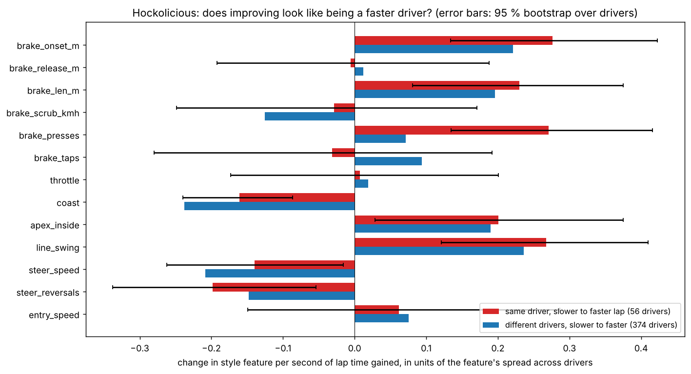

- After removing lap time and steering device there are no distinct style groups, only a continuum with two main axes.
- The `jadlakkisjad` laps in the repository are the RL agent's, not a human's (their inputs match the agent's saved `.inputs` files). Against humans of its speed it is an extreme outlier: steering reversals +8 standard deviations, steering speed +5.5, brake presses +6.

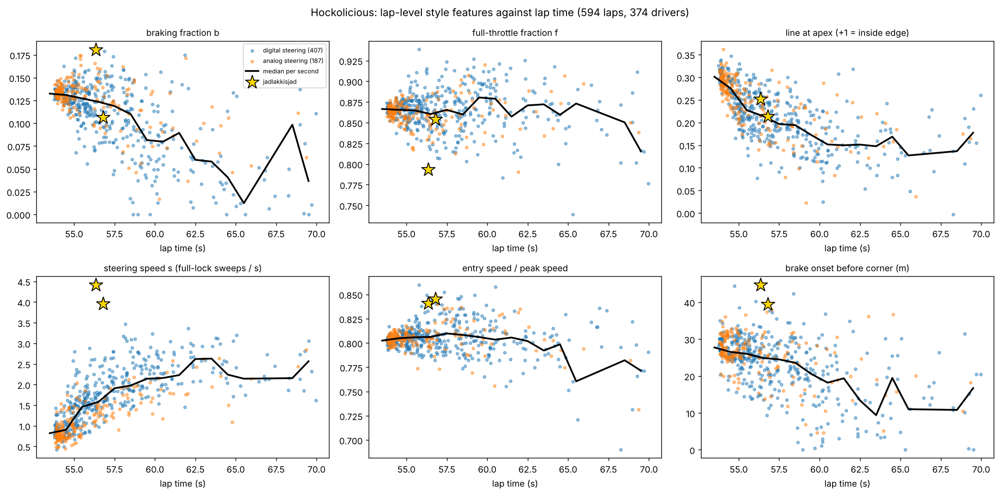

## 5. SAC and the binning

**Why change from IQN.** IQN picks one action from a fixed list, so steering can only take a few values. We want the agent to output the same three numbers Assetto Corsa takes:
steering in [-1, 1], throttle in [0, 1], brake in [0, 1], decided every 40 ms (4 physics ticks of 10 ms; 25 decisions per second, as in AssettoCorsaGym).

**Binning, in short.**
- Steering stays continuous. TMNF accepts any integer from -65536 to 65536, so nothing is binned for the game. Rounding it to a step of 0.1 or 0.2 is optional (measured on the 187 analog laps: error 0.015 or 0.030).
- TMNF pedals are on or off. A pedal level is played as the share of the 4 ticks in which the pedal is down, spread evenly: 0 = ....  0.25 = D...  0.5 = D.D.  0.75 = DDD.  1 = DDDD. So the pedal bins are 0, 0.25, 0.5, 0.75, 1 and come from the game, not from a design choice.
- The agent outputs continuous numbers; a small adapter rounds them to these levels and sends the pattern to the plugin, which applies it tick by tick. The rounded action is what goes into the replay buffer.

**SAC.** The actor outputs a Gaussian over the three numbers, squashed with tanh. Two Q networks, slowly moving targets, automatic temperature, n-step returns, uniform replay. It reads the same image and
float features as the IQN agent (one shared encoder, trained by the critic). SAC (off-policy, so the replay buffer is kept) rather than PPO.

**Driver style as a constraint (problem formulation).** Reward `r = w_p * (progress) - w_l * |distance to the reference line|`. At each corner exit a style cost measures how far the lap's `b, f, l, s` fall outside the
driver's range (taken from their fastest laps). A failure cost marks invalid laps. The adjusted reward is `r - lambda_s * c_style - lambda_f * c_fail`, and after each batch
`lambda_s <- max(0, lambda_s + eta (mean style cost - B))` and `lambda_f <- max(0, lambda_f + eta (failure rate - epsilon))`.

**Status (honest).** Built and tested offline: the per-corner style code shared by replays and the agent (identical output on all 617 replays), the action adapter with pedal patterns, the plugin message that
applies a pattern on every tick, the analog steering levels for IQN, and a steering estimate for keyboard replays. Written but not yet run: the SAC networks and update. Not built yet: the style-cost
and multiplier code, the reference-line inputs, the SAC training loop in the pipeline. Nothing has run in the game yet: the pedal duty-cycle response and the `InputType::Steer` call
in the plugin have to be checked there.

## 6. To decide at the meeting

1. Which track: Interlagos (best geometry, 3 drivers, Assetto Corsa only as a mod), Catalunya (13 drivers, mixed keyboard and analog, two thirds size) or Monza GP (official in Assetto Corsa, 5 drivers, under half size).
2. Is the goal transfer to Assetto Corsa (then the observations must match too) or a better human-like agent in TMNF?
3. Do we have laps of the target driver on the chosen track? The agent's laps are not a human style.
