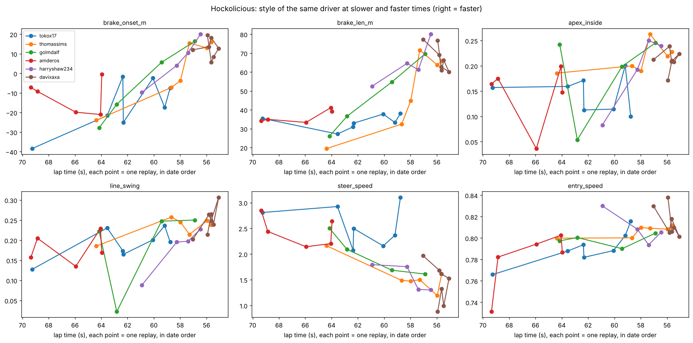
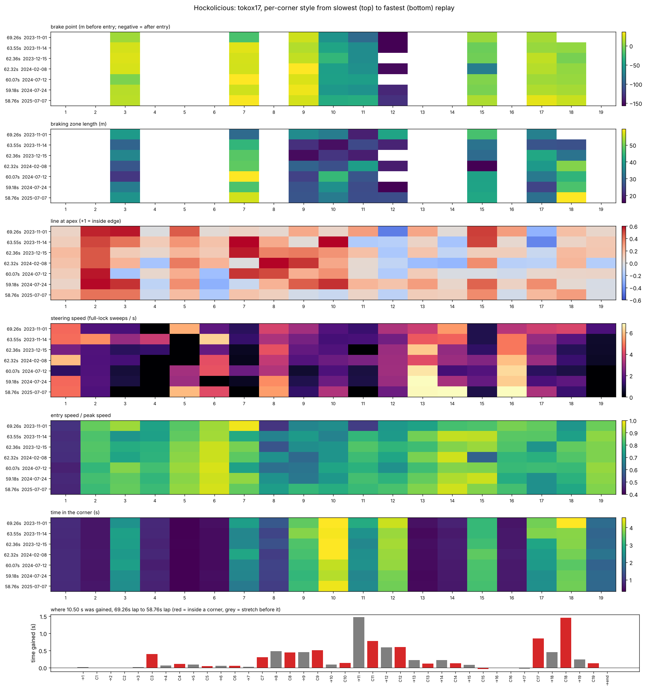

# Style vectors: ESL-Hockolicious

594 valid laps from 374 drivers (public replays from tmnf.exchange, track 414041, plus the two local laps saved under the login `jadlakkisjad`).
Every lap has one style vector per corner for 19 corners: `b` braking fraction, `f` full-throttle fraction,
`l` line (−1 outside edge … +1 inside edge, 32 m road assumed), `s` steering speed (full-lock sweeps per second),
plus entry speed and brake onset. No clustering has been run. Definitions and caveats are in
[docs/style-vectors.md](../docs/style-vectors.md).

> **The `jadlakkisjad` laps are the RL agent, not a human.** The input counts in the two Hockolicious replays match
> `weights-best-runs-data/run_name_to_be_changed/best_runs/hock_56340.inputs` and `hock_56800.inputs` to within one event
> (e.g. 56.34 s: 93 left, 75 right, 66 brake, 26 throttle presses; replay: 186 / 149 / 132 / 51 events, press plus release), and the Bahrain
> replay matches `Bahrain_40820…inputs` the same way. TMInterface saved the agent's laps under the game profile name.
> Everywhere below, "jadlakkisjad" means the agent. No human replay of yours is in the data yet.

## Files

| file | content |
|---|---|
| `Hockolicious/corners.csv` | one row per lap and corner (11,286 rows): the style vector and extras |
| `Hockolicious/laps.csv` | one row per lap: lap-level means, `steer_input` (analog / digital), RL conditioning values |
| `Hockolicious/drivers.csv`, `driver_style_vectors.csv` | one row per driver: best lap, number of laps, and the driver's mean style vector (feature × corner) |
| `Hockolicious/style_ranges.json` | min / max / mean / std of each style value per corner from each driver's 5 fastest laps |
| `Hockolicious/corners_def.json` | the 19 corners (start, apex, end in metres along the centerline) |
| `Hockolicious/skipped.csv` | the 22 replays not used, with the reason |
| `figures/` | the plots below |

## Median style by driver best-lap band

Median of the per-driver means. 374 drivers; the 20 fastest laps (49.5 to 53.5 s) take big cuts, are not on the centerline route and are not included.

| best lap (s) | drivers | b | f | l_apex | s | entry / peak speed | brake onset (m before corner) |
|:--|--:|--:|--:|--:|--:|--:|--:|
| < 54 | 17 | 0.13 | 0.87 | 0.30 | 0.79 | 0.80 | 26.7 |
| 54–56 | 147 | 0.13 | 0.87 | 0.25 | 1.13 | 0.81 | 26.1 |
| 56–58 | 81 | 0.12 | 0.86 | 0.20 | 1.68 | 0.81 | 24.9 |
| 58–62 | 94 | 0.09 | 0.87 | 0.19 | 2.17 | 0.81 | 21.0 |
| ≥ 62 | 35 | 0.05 | 0.86 | 0.14 | 2.42 | 0.79 | 14.0 |
| **the agent** (`jadlakkisjad`, 56.34 s) | 1 | 0.14 | 0.82 | 0.23 | **4.19** | 0.84 | **42.1** |

Faster drivers brake more, take a tighter line at the apex and steer less. Full-throttle fraction is flat across bands.
Steering speed and brake onset are where the agent is furthest from drivers of similar time.

## How the style vector is computed

Everything is **per corner and per lap first**, then averaged. The 19 corners are fixed segments of the track centerline
(`Hockolicious/corners_def.json`), so corner 7 means the same stretch of road for every driver. For each lap and corner
(`Hockolicious/corners.csv`):

| measure | how |
|---|---|
| braking zone | among the brake presses between the end of the previous corner (at most 200 m back) and the apex, the chain of presses (gaps under 0.4 s) that takes off the most speed. It counts as a zone if it removes at least 8 km/h over at least 10 m, otherwise the corner is "not braked" |
| `bz_onset_m` | metres before the corner entry where the zone starts (negative = braking starts after the entry) |
| `bz_release_m` | metres after the corner entry where the zone ends (positive = braking into the corner, i.e. trail braking) |
| `bz_len_m`, `bz_scrub_kmh`, `bz_presses` | zone length, speed taken off, number of separate presses (more than 1 = pumping the brake) |
| `f` | share of the corner's time with throttle on and brake off |
| `l_entry / l_apex / l_exit` | lateral offset from the centerline at the corner start / apex / end, divided by half the road width (assumed 32 m), signed so +1 is the inside edge |
| `s` | steering speed: total change of the steering command (full lock = 1) per second inside the corner |
| `v_entry_ratio` | speed at the corner entry divided by the lap's peak speed |

Per-corner values for every lap are in `corners.csv`; the per-corner figures below show them. The braking corners on this track are
3, 7, 9, 10, 11, 12, 15, 17 and 18 (a braking zone in more than half of all laps). Corners 1, 2, 4, 5, 8, 13, 14, 16 and 19 are taken without braking.

A first version used "share of the corner's time spent braking". It missed braking that happens before the corner and could not tell
a clean brake from pumping, so it was replaced by the braking-zone measures above.

## Does the same driver change style as they get faster?

Yes, we have that data. TMX keeps a driver's improving personal bests, so 102 of the 374 drivers have 2 or more replays at different times
and dates, and 56 of them improved by at least 0.5 s (the later replay is the faster one in 99 % of cases). The biggest improvers:
`tokox17` 69.26 s to 58.76 s over 7 replays (2023 to 2025), `thomassims` 64.38 to 55.63 s, `golmdalf` 64.16 to 56.89 s, `harryshaw234` 60.92 to 56.45 s.

**When a driver improves, their style changes in the same direction and by about the same amount as the difference between slower and faster drivers.**
Per second of lap time gained, in units of the spread of each feature across drivers (`Hockolicious/progress_within_vs_between.csv`):

| feature | same driver, slow to fast (56 drivers) | different drivers, slow to fast (374) |
|---|--:|--:|
| brake point (starts further before the corner) | +0.28 | +0.22 |
| braking zone length | +0.23 | +0.20 |
| apex line (more inside) | +0.20 | +0.19 |
| line swing | +0.27 | +0.24 |
| coasting | −0.16 | −0.24 |
| steering speed | −0.14 | −0.21 |
| steering reversals | −0.20 | −0.15 |
| brake presses | +0.27 | +0.07 |

In both comparisons faster drivers start braking further before the corner entry and brake for longer. Throttle share, brake release point and entry speed barely change in either comparison.
Braking-press count is the one feature where improving drivers move more than the population does.

Per-corner view of one driver, slowest replay at the top and fastest at the bottom, with where the 10.5 s were gained
(1.5 s on the stretch before corner 11, 1.45 s in corner 18, 0.85 s in corner 17, 0.77 s in corner 11; the other sections 0 to 0.6 s each):

Also `Hockolicious_progress_thomassims.png` and `Hockolicious_progress_golmdalf.png`. Regenerate with
`python scripts/driver_progress.py ../style_vectors/Hockolicious ../replays/tmnf_exchange/Hockolicious/manifest.csv --drivers tokox17,thomassims`.

## Driver style groups

`linesight/scripts/cluster_driver_styles.py`. Each driver becomes one vector of 13 features (mean over their laps): the six braking-zone
measures over the 9 braking corners, throttle share, coasting, apex line, line swing, steering speed, steering reversals and entry speed.
These repeat well: split-half reliability (two random halves of the 102 drivers with 2 or more laps) is 0.6 to 0.9 for all but the brake
taps (0.58). Lap time and steering device (pad vs keyboard) explain 40 to 60 % of brake point, coasting, line swing and steering speed, so
both are regressed out before clustering. Without that, clustering just recovers speed tiers.

Models: Gaussian mixtures (1 to 8 components, three covariance shapes, BIC), k-means silhouette against column-shuffled data, and a stability
check on 80 % subsets.

| | raw features | skill- and device-adjusted |
|---|---|---|
| best BIC | k = 3 | k = 2 |
| k-means silhouette, k = 2 | 0.29 (shuffled 95 %: 0.12) | 0.14 (shuffled 95 %: 0.07) |
| stability (ARI) | not computed | 0.52 |
| clusters differ in mean style? | yes, speed tiers | **no**: largest cluster-mean z is 0.24 (tight core vs wide spread) |

**Result: once speed and device are removed, there are no distinct style groups among these drivers, only a continuum.**
The two main axes are in `figures/Hockolicious_style_axes.png`. Per-driver coordinates, the 2-cluster labels and posterior probabilities
are in `Hockolicious/driver_style_clusters.csv`, and every number in `Hockolicious/style_clusters.json`.

**Where the agent sits.** Relative to human drivers of its speed it is an extreme outlier: steering reversals +8.4 σ, brake presses +6.2 σ
(it pumps the brake), steering speed +5.5 σ, brake point +3.1 σ, entry speed +2.3 σ, line swing +2.0 σ, throttle share −1.8 σ.
`Hockolicious/style_neighbours_jadlakkisjad.csv` lists the 10 closest faster drivers with their feature differences.

## Figures

**Style features against lap time** (one dot per lap, star = `jadlakkisjad`)

**Mean style vector per corner for each best-lap band** (bottom row of each panel = the agent). Blank = corner not braked.

**Band minus the agent per corner** (red = the band has more of it than the agent)

**Speed, line and braking along the track per lap-time band** (black = `jadlakkisjad`)

**Corner segmentation**

Regenerate: `cd linesight && python scripts/extract_style_vectors.py ../replays --out ../style_vectors && python scripts/analyze_style_vectors.py ../style_vectors`
