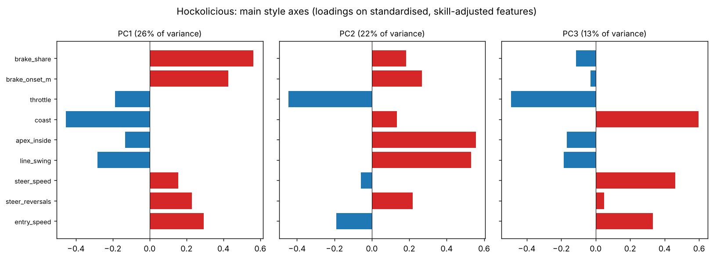
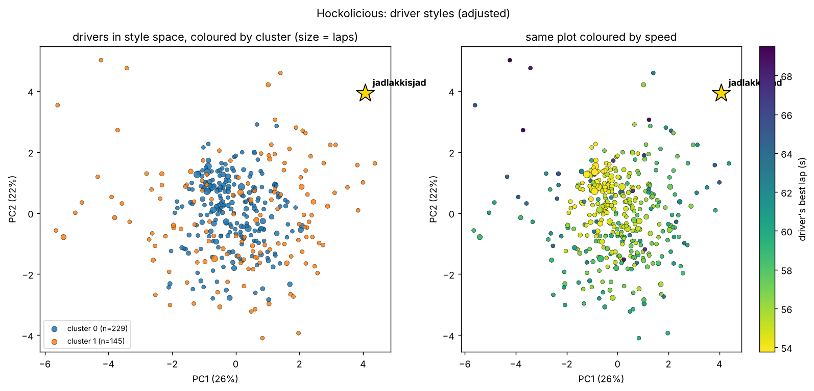
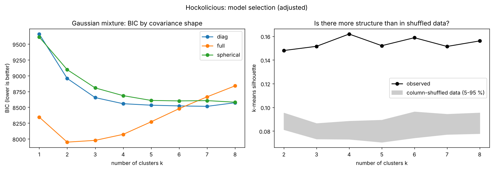
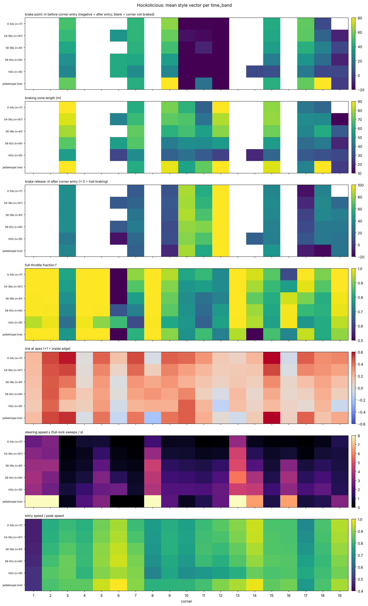
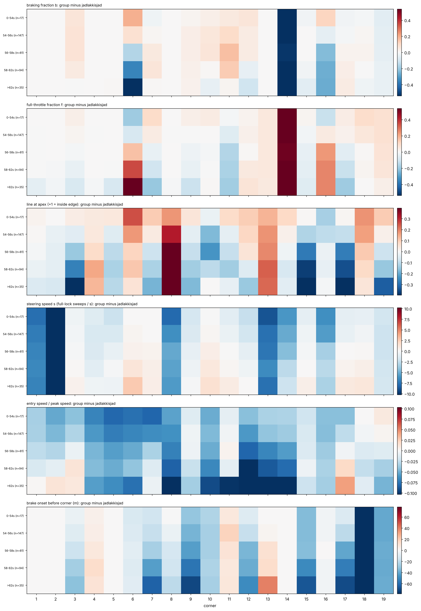
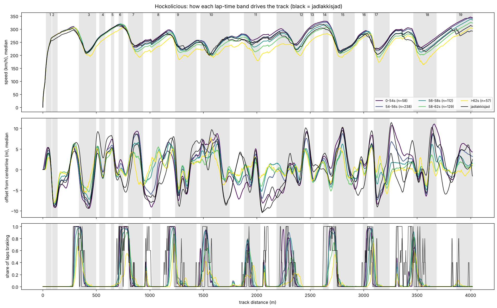
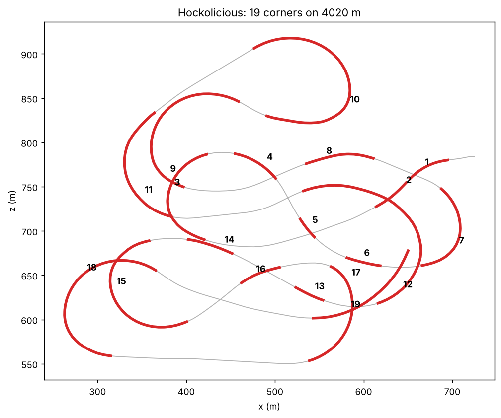

# Style vectors: ESL-Hockolicious

594 valid laps from 374 drivers (public replays from tmnf.exchange, track 414041, plus the two local laps saved under the login `jadlakkisjad`).
Every lap has one style vector per corner for 19 corners: `b` braking fraction, `f` full-throttle fraction,
`l` line (−1 outside edge … +1 inside edge, 32 m road assumed), `s` steering speed (full-lock sweeps per second),
plus entry speed and brake onset. No clustering has been run. Definitions and caveats are in
[docs/style-vectors.md](../docs/style-vectors.md).

> **The `jadlakkisjad` laps are the RL agent, not a human.** The input counts in the two Hockolicious replays match
> `weights-best-runs-data/run_name_to_be_changed/best_runs/hock_56340.inputs` and `hock_56800.inputs` to within one event
> (e.g. 56.34 s: 93 left, 75 right, 66 brake, 26 throttle presses; replay: 186 / 149 / 132 / 51 events, press plus release), and the Bahrain
> replay matches `Bahrain_40820…inputs` the same way. TMInterface saved the agent's laps under the game profile name.
> Everywhere below, "jadlakkisjad" means the agent. No human replay of yours is in the data yet.

## Files

| file | content |
|---|---|
| `Hockolicious/corners.csv` | one row per lap and corner (11,286 rows): the style vector and extras |
| `Hockolicious/laps.csv` | one row per lap: lap-level means, `steer_input` (analog / digital), RL conditioning values |
| `Hockolicious/drivers.csv`, `driver_style_vectors.csv` | one row per driver: best lap, number of laps, and the driver's mean style vector (feature × corner) |
| `Hockolicious/style_ranges.json` | min / max / mean / std of each style value per corner from each driver's 5 fastest laps |
| `Hockolicious/corners_def.json` | the 19 corners (start, apex, end in metres along the centerline) |
| `Hockolicious/skipped.csv` | the 22 replays not used, with the reason |
| `figures/` | the plots below |

## Median style by driver best-lap band

Median of the per-driver means. 374 drivers; the 20 fastest laps (49.5 to 53.5 s) take big cuts, are not on the centerline route and are not included.

| best lap (s) | drivers | b | f | l_apex | s | entry / peak speed | brake onset (m before corner) |
|:--|--:|--:|--:|--:|--:|--:|--:|
| < 54 | 17 | 0.13 | 0.87 | 0.30 | 0.79 | 0.80 | 26.7 |
| 54–56 | 147 | 0.13 | 0.87 | 0.25 | 1.13 | 0.81 | 26.1 |
| 56–58 | 81 | 0.12 | 0.86 | 0.20 | 1.68 | 0.81 | 24.9 |
| 58–62 | 94 | 0.09 | 0.87 | 0.19 | 2.17 | 0.81 | 21.0 |
| ≥ 62 | 35 | 0.05 | 0.86 | 0.14 | 2.42 | 0.79 | 14.0 |
| **jadlakkisjad** (56.34 s) | 1 | 0.14 | 0.82 | 0.23 | **4.19** | 0.84 | **42.1** |

Faster drivers brake more, take a tighter line at the apex and steer less. Full-throttle fraction is flat across bands.
Steering speed and brake onset are where the agent is furthest from drivers of similar time.

## Driver style groups

`linesight/scripts/cluster_driver_styles.py`. Each driver becomes one compact vector of 9 features (mean over their laps):
brake share and brake point on the 10 braking corners, throttle share, coasting, apex line, line swing (apex minus entry / exit),
steering speed, steering reversals, entry speed. These are far more repeatable than single corners: split-half reliability
(two random halves of the 102 drivers with 2+ laps) is 0.6 to 0.9. Lap time and steering device (pad vs keyboard) explain 40 to 60 %
of brake point, coasting, line swing and steering speed, so both are regressed out before clustering. Without that, clustering just
recovers speed tiers (PC1 correlates −0.93 with lap time).

Models: Gaussian mixtures (1 to 8 components, spherical / diagonal / full covariance, BIC), k-means silhouette against column-shuffled data,
and a stability check on 80 % subsets.

| | raw features | skill- and device-adjusted |
|---|---|---|
| best BIC | k = 4 | k = 2 |
| k-means silhouette (k = 2…8) | 0.18 to 0.32, shuffled 95 % ≈ 0.12 | 0.15 to 0.16, shuffled 95 % ≈ 0.09 |
| stability (ARI) | not computed | 0.71 |
| clusters differ in mean style? | yes, speed tiers | **no**: largest cluster-mean z is 0.30 (the split is tight core vs wide spread) |

**Result: once speed and device are removed, there are no distinct style groups among these drivers, only a continuum.**
It has two main axes (`figures/Hockolicious_style_axes.png`): PC1 (26 %) is brake hard and early and never coast versus coast and lift,
and PC2 (22 %) is wide entry, deep apex and big line swing versus straight, throttle-heavy lines. The per-driver coordinates,
the 2-cluster labels and posterior probabilities are in `Hockolicious/driver_style_clusters.csv`, and every number in `Hockolicious/style_clusters.json`.

**Where the agent sits.** Relative to human drivers of its speed it is an extreme outlier: steering reversals +8.4 σ, steering speed +5.5 σ,
brake point +3.4 σ (it brakes about 15 m earlier), entry speed +2.3 σ, line swing +2.0 σ, throttle share −1.8 σ. Its distance to the nearest
faster human in style space is about 9 to 10, against a typical driver-to-driver distance of a few units.
`Hockolicious/style_neighbours_jadlakkisjad.csv` lists the 10 closest faster drivers with their feature differences.

## Figures

**Style features against lap time** (one dot per lap, star = `jadlakkisjad`)

**Mean style vector per corner for each best-lap band** (bottom row of each panel = `jadlakkisjad`)

**Band minus the agent per corner** (red = the band has more of it than the agent)

**Speed, line and braking along the track per lap-time band** (black = `jadlakkisjad`)

**Corner segmentation**

Regenerate: `cd linesight && python scripts/extract_style_vectors.py ../replays --out ../style_vectors && python scripts/analyze_style_vectors.py ../style_vectors`
