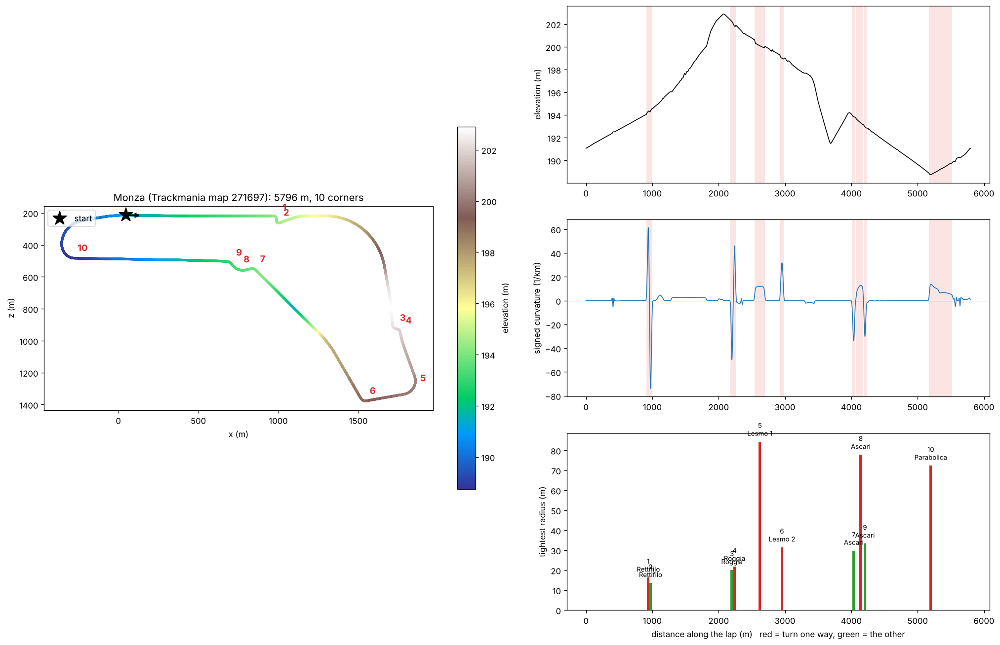

# Monza as built in Trackmania 2020

Map: [F1 Autodromo Nazionale di Monza V1](https://trackmania.exchange/mapshow/271697) by Tartore13 (map 271697, in the mappack
"Formula 1 (and other) Tracks with elevation map"). `monza.Map.Gbx` is the file downloaded from trackmania.exchange.

The map has no road blocks. The road is 9 custom meshes (`monza1` to `monza9`) embedded in the map file, so the geometry was read
from the meshes: `linesight/scripts/tools/tm2020_map_dump` (C#, GBX.NET) extracts them and
`linesight/scripts/tools/tm2020_centerline.py` turns the road surface into a centerline. Pieces placed as
`world = R_yaw (local + pivot) + position` join with a gap of 0.0 m at every joint, which is how the placement rule was checked.

| file | content |
|---|---|
| `centerline.npy` | 11,594 points (x, y, z) 0.5 m apart, one lap from the start gantry. Same format as `linesight/maps/*.npy` |
| `width.npy` | road width at each point (m) |
| `summary.json` | lap length, width, elevation range |
| `layout.png` | top-down map coloured by elevation, elevation profile, curvature, tightest radius per corner |



## What the numbers say

| | Trackmania map | real circuit |
|---|---|---|
| lap length | 5,796.6 m | 5,793 m (official figure), difference +0.06 % |
| road width | 10.2 m median, up to 12.5 m on the main straight | not checked |
| elevation range | 14.2 m (188.7 to 202.9 in map coordinates) | not checked |
| corners (curvature threshold 1/250 m) | 10, listed below | 11 named turns |
| lap direction | clockwise when z is drawn downwards | clockwise |

Corner sequence in map order, with the turn direction (+ = right, assuming the clockwise lap):

| # | start (m) | angle | tightest radius | matches real turn |
|--:|--:|--:|--:|---|
| 1 | 911 | 90° right | 16 m | Variante del Rettifilo, right |
| 2 | 958 | 110° left | 14 m | Variante del Rettifilo, left |
| 3 | 2179 | 67° left | 20 m | Variante della Roggia, left |
| 4 | 2223 | 61° right | 22 m | Variante della Roggia, right |
| 5 | 2541 | 97° right | 84 m | Lesmo 1, right |
| 6 | 2925 | 68° right | 31 m | Lesmo 2, right |
| 7 | 4011 | 58° left | 30 m | Variante Ascari, left |
| 8 | 4075 | 64° right | 78 m | Variante Ascari, right |
| 9 | 4186 | 46° left | 33 m | Variante Ascari, left |
| 10 | 5173 | 166° right | 72 m | Parabolica, right |

Curva Grande (the long right-hander after the first chicane, about 330 m radius) is below the corner threshold and is not in this list.
The real turn names and directions in the last column are from memory of the circuit, not from a data source.

## What is not done yet

The question was how accurate the map is against the real circuit and against Assetto Corsa. Only lap length and the order and
direction of the corners can be compared without more data, and both match. A shape and elevation comparison needs:
- **the real outline**, from OpenStreetMap (`overpass-api.de` is not reachable from this environment) or a GPX / CSV you trust;
- **the Assetto Corsa track**, for example `content/tracks/monza/ai/fast_lane.ai` from your install (the AI line, which has x, y, z per
  point). I can't download AC content from here.

With those, the plan is: scale and rotate each outline onto the map's centerline (allowing a mirror), then compare lap length,
corner positions along the lap, radii, the curvature profile and the elevation profile, side by side.

Regenerate:
```
cd linesight/scripts/tools/tm2020_map_dump && dotnet run -- ../../../../tracks/monza/monza.Map.Gbx /tmp/monza_dump
cd ../../.. && python scripts/tools/tm2020_centerline.py /tmp/monza_dump --out ../tracks/monza --start-item yjhfgjx
python scripts/tools/plot_track_layout.py ../tracks/monza/centerline.npy --title "Monza (Trackmania map 271697)" --out ../tracks/monza/layout.png --flip-z
```
Needs .NET 8 and `pip install scikit-image scipy numpy matplotlib`.
